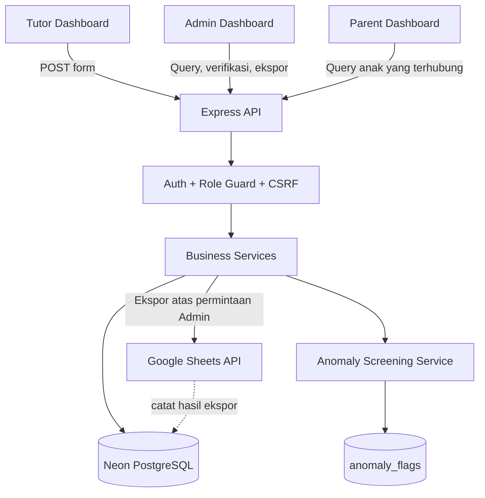

# Technical Architecture

## 1. Prinsip arsitektur

- React frontend tidak mengakses Neon atau Google Sheets secara langsung.
- Express menjadi boundary API dan otorisasi.
- Neon PostgreSQL menjadi source of truth untuk master data dan catatan pertemuan.
- Google Sheets adalah target ekspor laporan bulanan yang dipicu Admin, bukan data source untuk submit tutor.
- Satu tabel `lesson_sessions` memasok Data Absensi Admin, Riwayat Mengajar Tutor, Rekap, Honor, dan Progress Anak melalui query/API dengan role filter.
- Admin/Tutor login dengan username + password; Orang Tua login dengan ID Akses Orang Tua acak/rahasia tanpa password. Kode akses adalah credential, bukan ID publik.
- Browser memakai opaque session cookie HttpOnly/SameSite, Secure di production, origin allowlist dan CSRF protection. Baseline menggunakan server-side session store PostgreSQL (mis. `express-session` + store PostgreSQL); jangan memakai default MemoryStore untuk production atau menyimpan session credential di localStorage.
- Modul anomaly mengklasifikasikan dugaan duplikasi/pola anomali setelah data tersimpan. Validasi dasar tetap deterministik; temuan tidak mengubah status/honor tanpa review Admin.
- Aturan honor deterministik di backend; demo memakai Rp50.000 per sesi dari seed tarif dengan label simulasi.

## 2. Diagram arsitektur



## 2.1 Autentikasi dan keamanan akses

- Admin/Tutor login dengan username + password; hash password menggunakan Argon2id atau bcrypt.
- Parent login hanya dengan ID Akses Orang Tua acak/rahasia. Kode minimal memiliki entropi tinggi, bukan ID publik, ID berurutan atau NPM siswa. Simpan HMAC digest dengan `PARENT_ACCESS_CODE_PEPPER`, lakukan rate limiting dan tampilkan kode mentah hanya saat generate/rotate.
- Gunakan session cookie HttpOnly, SameSite=Lax dan Secure di production, origin allowlist, CORS yang dibatasi, serta CSRF token/validasi Origin untuk request mutasi. Jangan simpan credential di localStorage atau log.
- Parent hanya dapat mengakses siswa melalui `parent_students`; Tutor hanya data miliknya. Semua policy diterapkan backend.

## 3. Stack

- Frontend: React 19.x + Vite + TypeScript strict, Tailwind CSS v4, Headless UI, React Router, Axios, TanStack Query, React Hook Form/Zod, Recharts, TanStack Table.
- Backend: Node.js 22+, Express 5, TypeScript, Zod.
- Persistence: Neon PostgreSQL, Drizzle ORM/Kit, `pg` Pool.
- Integrasi Sheets: `googleapis` dan service account/API credential pada backend.
- Anomaly screening adalah bagian baseline. Adapter model Gemini mengklasifikasikan kandidat duplikasi/pola saat credential siap; local/offline tests menggunakan fake detector yang jelas diberi label. Provider yang belum tersedia dicatat `not_evaluated`/`failed`, bukan fake success.
- PDF bukan output baseline. Tambahkan generator PDF hanya jika owner menyetujui scope tambahan; laporan bulanan utama diekspor langsung ke Google Sheets.
- Test: Vitest, Supertest, React Testing Library.

## 4. Struktur repository yang dituju

```text
.
├── README.md
├── docs/
├── examples/                     # fixtures sintetis untuk seed/test saja
├── packages/
│   └── contracts/src/            # shared Zod schema + TypeScript types
├── frontend/
│   └── src/
│       ├── app/                  # router, providers, role layouts
│       ├── components/ui/        # komponen UI internal
│       ├── features/
│       │   ├── auth/
│       │   ├── admin-dashboard/
│       │   ├── attendance/       # admin list/detail/review
│       │   ├── tutor/             # form, riwayat, honor
│       │   ├── parent/            # progress anak
│       │   ├── master-data/       # tutor, siswa, parents, subjects, assignments, rates
│       │   ├── recap/
│       │   ├── payroll/
│       │   └── exports/
│       └── lib/                  # api-client, formatters, query keys
└── backend/
    ├── src/
    │   ├── app.ts
    │   ├── server.ts
    │   ├── config/
    │   ├── db/                   # Drizzle schema/client
    │   ├── middleware/           # auth, role checks, error handling
    │   ├── routes/
    │   ├── services/             # attendance, recap, payroll, exports
    │   └── integrations/
    │       ├── google-sheets/    # report export adapter only
    │       └── anomaly/          # anomaly adapter / model provider
    ├── drizzle/
    ├── tests/
    └── drizzle.config.ts
```

Agent boleh merapikan struktur jika repository existing berbeda, tetapi pemisahan tanggung jawab dan kontrak harus tetap jelas.

## 5. Submit form — urutan server

1. User Tutor yang terautentikasi mengirim `assignment_id`, `lesson_date`, `duration_minutes`, `learning_material`, `learning_notes`, dan `next_focus`.
2. Middleware memverifikasi role `tutor`; backend mengambil `tutor_id` dari session, bukan dari body.
3. Backend memastikan assignment aktif dan milik tutor login, memvalidasi tanggal/durasi/data wajib, lalu menyimpan `lesson_sessions` dengan status `pending`, `anomaly_analysis_status=pending`, `submitted_at`, dan `updated_at`.
4. Setelah commit database, anomaly service mengklasifikasikan kandidat dugaan duplikasi/pola. Temuan ditulis ke `anomaly_flags`; analisis harus memiliki timeout/fallback dan tidak menggagalkan record yang sudah tersimpan.
5. Endpoint mengembalikan `201` setelah sesi tersimpan di Neon dengan `anomaly_analysis_status=pending`; screening berjalan di proses backend terpisah dan memperbarui status/flags. Proses harus menangkap error dan, saat startup, melanjutkan sesi berstatus analisis pending agar restart tidak membuat status menggantung. Baseline mengasumsikan satu worker anomaly aktif; cegah pemrosesan sesi yang sama dua kali di dalam proses. Jika deployment memakai beberapa instance/worker, implementasikan claim/lock berbasis PostgreSQL atau durable job queue sebelum scale-out. Frontend mengonfirmasi “Absensi tersimpan dan menunggu verifikasi”; status analisis ditampilkan terpisah. Jangan mengembalikan status analisis yang tidak aktual.
6. Tidak ada call Google Sheets pada alur submit.

## 6. Query peran dan periode

- Admin: query list/detail dapat menjangkau sesi operasional sesuai izin; filter `period`, tutor, siswa, subject, status dan pencarian.
- Tutor: setiap query attendance harus memiliki filter tutor dari session terautentikasi; jangan menggunakan bearer/JWT token sebagai kontrak auth baseline. Jangan percaya tutor ID yang dikirim client.
- Parent: query siswa harus melalui `parent_students`; query sesi dipersempit ke siswa terhubung dan status yang boleh ditampilkan.
- `period=YYYY-MM` diterjemahkan sebagai rentang tanggal `lesson_date >= first_day AND lesson_date < first_day_of_next_month`.
- Tanggal sesi menggunakan PostgreSQL `DATE`; timestamps pencatatan/verifikasi menggunakan `TIMESTAMPTZ`.

## 7. Alur verifikasi

Status `lesson_sessions.status`: `pending`, `approved`, `revision_requested`, `rejected`. Status awal selalu `pending`; Admin meninjau manual sebelum sesi dihitung ke honor.

- Submit baru: `pending`.
- Admin `approved`: dapat masuk rekap/honor dan Progress Anak.
- Admin `revision_requested`: tutor dapat mengedit dan submit revisi; status kembali `pending`.
- Admin `rejected`: tidak masuk honor; alasan disimpan pada `admin_note`.
- Status anomali tersimpan terpisah pada `anomaly_flags`; finding bukan status sesi dan bukan keputusan final.

## 8. Ekspor Google Sheets

Lihat `16-GOOGLE-SHEETS-MONTHLY-EXPORT.md`. Inti alur:

1. Admin memilih periode `YYYY-MM`, lalu memicu ekspor.
2. Backend memverifikasi role admin dan konfigurasi integration.
3. Query sesi dari Neon berdasarkan `lesson_date`; semua sesi tanpa filter status review yang diekspor (keputusan ekspor semua status review sudah dikonfirmasi owner, lihat `17-DECISIONS-AND-OPEN-QUESTIONS.md`).
4. Pemetaan menghasilkan delapan kolom mentah saja; materi, catatan, status, anomaly, honor, ID internal tidak ikut ekspor. `no` dibuat ulang sebagai nomor urut laporan.
5. Backend membuat tab `Absensi YYYY-MM` bila belum ada; jika ada, tulis ulang range yang dihasilkan tanpa append duplikat. Untuk tab existing, jangan clear report lama sebelum payload baru siap; utamakan atomic `spreadsheets.batchUpdate` untuk menulis data baru sekaligus membersihkan sisa cell A:H.
6. Catat hasil di `sheet_export_runs`. Jika API gagal, tandai gagal dan pertahankan seluruh data Neon.
7. Tidak ada ekspor otomatis saat submit. Re-export hanya terjadi atas tindakan admin.

## 9. Payroll

- Jangan hard-code tarif contoh ke service.
- Konfigurasi tarif development ada di `tutor_rates`: `per_session`, Rp50.000, `is_demo_assumption=true`. Ini bukan tarif resmi; kalkulator membaca tarif dari data tabel/seed.
- Saat sesi disetujui, cari rate yang efektif pada `lesson_date`, lalu simpan snapshot jenis/nilai/flag demo ke `lesson_sessions`. Snapshot tidak mengikuti perubahan tarif berikutnya. Jika tarif tidak ditemukan, sesi tetap dapat direview tetapi honor harus menampilkan peringatan dan tidak mengarang nominal.
- Hanya sesi approved dihitung. Sesi pending/revision/rejected tidak masuk estimasi honor final.
- Gunakan PostgreSQL `numeric` dan decimal arithmetic, jangan floating point untuk nominal uang.
- MVP menghitung estimasi honor, bukan menyatakan pembayaran sudah terjadi. Tracking pembayaran adalah fitur terpisah yang harus dikonfirmasi.

## 10. Setup Neon + Drizzle

- `DATABASE_URL`: pooled connection untuk runtime API.
- `DATABASE_MIGRATION_URL`: direct/unpooled connection untuk Drizzle Kit jika digunakan.
- Buat migration yang dapat direview; jangan hanya mengandalkan schema push untuk state bersama.
- Jangan menjalankan seed/destructive migration terhadap database UMKM tanpa izin.

## 11. Integrasi dan error handling

- Google Sheets API hanya di backend. Credential harus punya akses Editor untuk target spreadsheet karena fitur menulis report.
- Jangan mengekspos credential melalui `VITE_*`, response API, browser storage, atau log.
- Jika Google Sheets belum dikonfigurasi, endpoint export mengembalikan error terstruktur/503. Tampilan tidak boleh memberi label berhasil.
- Jika provider AI tidak tersedia, alur submit, verifikasi, rekap dan export tetap berfungsi; status analisis menjadi `failed`/`not_evaluated`, bukan sukses palsu.
- Jangan menambahkan queue/Redis sebelum kebutuhan volume/latency menunjukkan kebutuhan.

## 12. Referensi teknis

- Drizzle + Neon: https://orm.drizzle.team/docs/get-started/neon-existing
- Neon connection: https://neon.com/docs/get-started/connect-neon
- Google Sheets values API: https://developers.google.com/workspace/sheets/api/guides/values
- Google Sheets batch update: https://developers.google.com/workspace/sheets/api/reference/rest/v4/spreadsheets.values/batchUpdate
- Google service account credentials: https://developers.google.com/workspace/guides/create-credentials
- Google Gen AI SDK: https://github.com/googleapis/js-genai
