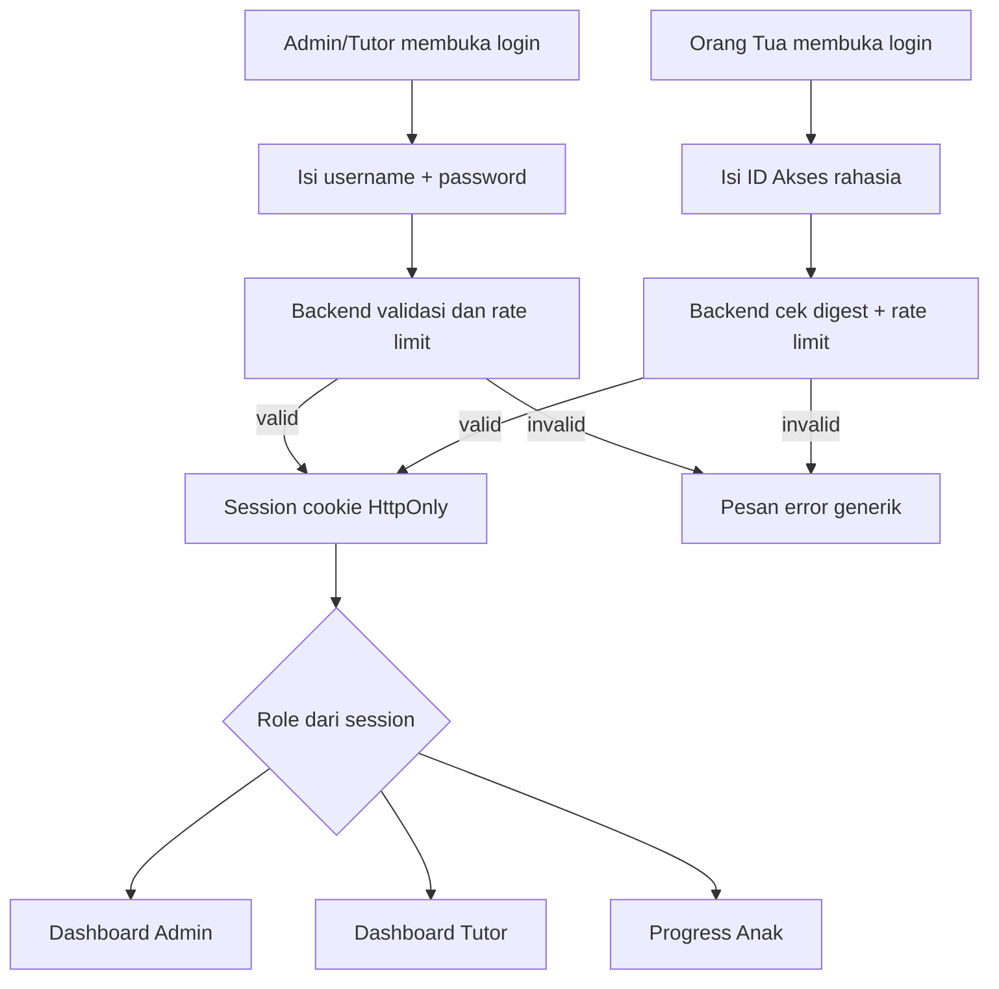
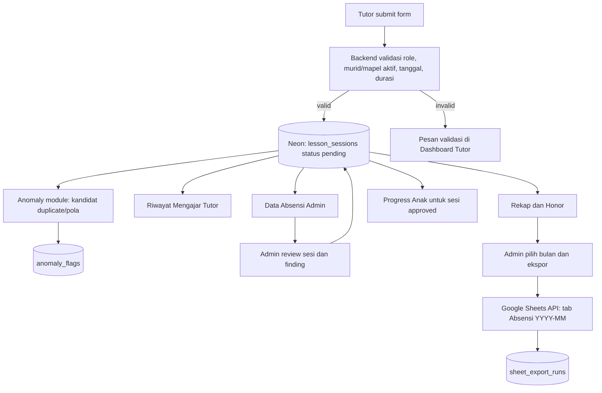

# User Flows — Admin, Tutor, Orang Tua, Anomali, dan Ekspor Bulanan

Semua dashboard membaca sumber data yang sama dari Neon melalui API. Tidak ada dashboard yang mengambil data dari halaman dashboard role lain.

## 1. Auth flows

ID Akses Orang Tua adalah secret credential yang dibuat acak/berentropi tinggi, bukan student ID, NPM publik, nomor telepon, tanggal lahir atau kode berurutan. Backend menyimpan digest berkunci dan hanya memperlihatkan kode mentah saat dibuat/dirotasi. Parent hanya dapat melihat siswa terhubung di `parent_students`.

Browser menggunakan session cookie `HttpOnly`, `SameSite=Lax`, `Secure` di production, CORS origin allowlist dan CSRF protection untuk mutasi. Jangan menyimpan session token atau kode akses di localStorage.

## 2. Ringkasan alur data

Tidak ada panah Tutor → Google Sheets pada saat submit. AI/anomaly provider tidak boleh menggagalkan data yang telah disimpan ke Neon.

## 3. Flow Tutor — submit sesi

1. Tutor login dengan username + password.
2. Buka `Form Absensi`.
3. Frontend meminta pilihan murid dan mata pelajaran aktif dari API (`GET /tutor/attendance-options`).
4. Nama tutor, kelas, dan sekolah ditentukan/diisi dari data master; Tutor memilih sendiri murid (kotak pencarian) dan mapel; kelas & sekolah terisi otomatis dari murid.
5. Tutor mengisi tanggal sesi, durasi dalam menit, materi pembelajaran, catatan opsional, dan fokus berikutnya opsional.
6. Frontend memvalidasi untuk UX; backend memvalidasi secara otoritatif (session, murid/mapel aktif, tanggal, durasi, field wajib).
7. Backend menyimpan satu record `lesson_sessions` berstatus `pending`, `submitted_at`, dan `anomaly_analysis_status='pending'`.
8. Setelah commit DB, anomaly module menjalankan screening. Proses ini tidak boleh mengganti status sesi/menolak sesi. Bila AI error, catat `failed` atau `not_evaluated`; submit tetap berhasil.
9. UI mengonfirmasi “Absensi tersimpan dan menunggu verifikasi” setelah DB berhasil. Jika analisis belum selesai, tampilkan status analisis secara terpisah.
10. Google Sheets tidak dipanggil pada flow submit.

Gunakan perlindungan double-submit/idempotency bila request diulang. Jangan membuat record kedua hanya karena UI mengalami timeout tanpa memeriksa hasil request pertama.

## 4. Flow Anomaly — dugaan duplikasi dan pola tidak wajar

1. Setelah sesi masuk Neon, backend menjalankan validasi deterministik terhadap field murid/mapel serta membangun kandidat yang relevan.
2. Anomaly service mengklasifikasikan kemungkinan `suspected_duplicate`, `duration_outlier`, atau `unusual_pattern`. AI boleh membandingkan fitur/session ID pseudonymous, bukan nama/PII.
3. Finding disimpan di `anomaly_flags`, termasuk sesi pembanding jika ada, alasan/evidence ringkas, provider/model, dan status review manusia. Status proses agregat (`pending/completed/failed/not_evaluated`) hanya disimpan di `lesson_sessions.anomaly_analysis_status`, bukan pada setiap finding.
4. Admin melihat indikator pada Data Absensi dan memeriksa data asli.
5. Admin menandai finding sebagai anomaly terkonfirmasi, false positive atau resolved. Status sesi (`pending/approved/revision_requested/rejected`) diubah melalui keputusan absensi terpisah.
6. Tidak ada auto-delete, auto-reject atau penurunan honor hanya karena AI menemukan kemiripan. Dua sesi mirip mungkin sama-sama valid.

Jika model belum dikonfigurasi, gunakan fake detector hanya pada development/test dan labeli dengan jelas; live UI harus menandai `not_evaluated`, bukan menampilkan hasil model palsu.

## 5. Flow Tutor — Riwayat Mengajar

1. Tutor membuka `Riwayat Mengajar`.
2. API mengembalikan sesi berdasarkan tutor dari session, bukan `tutor_id` kiriman browser.
3. Default periode bulan berjalan; tutor dapat memilih bulan lain.
4. Daftar menampilkan tanggal, murid, kelas, mapel, durasi, status, dan ringkasan materi.
5. Detail dapat menampilkan timestamp submit/review dan catatan Admin yang diperlukan untuk revisi. Metadata review melekat ke payload saat ini; setelah revisi dikirim metadata itu direset pada baseline (riwayat penuh adalah future/P1).
6. Jika `revision_requested`, tutor memperbaiki field yang diizinkan lalu submit ulang pada record yang sama. Backend memperbarui `submitted_at` untuk payload terbaru, mengosongkan `reviewed_by_user_id`, `reviewed_at`, dan `admin_note`, mengembalikan status sesi ke `pending`, menandai finding payload lama `superseded`, mereset `anomaly_analysis_status` ke `pending`, lalu menjadwalkan screening ulang.
7. Working default O-15: Tutor tidak dapat mengubah sesi `approved` atau `rejected`; keduanya terminal dan tidak ada endpoint reopen. Kebijakan ini belum dikonfirmasi owner. Jika UMKM perlu koreksi setelah keputusan final, konfirmasi sebelum implementasi lalu ubah state machine, API, audit trail, dan tests bersama-sama.

## 6. Flow Admin — Data Absensi dan review

1. Admin login dengan username + password.
2. Admin membuka `Data Absensi`, default bulan berjalan.
3. Tabel menampilkan delapan kolom inti, ditambah status review, indikator anomaly, dan menu aksi.
4. Filter berdasarkan bulan, tutor, siswa, mapel, status, anomaly, atau pencarian.
5. Admin membuka detail dan memeriksa data serta finding anomaly.
6. Admin memilih `approved`, `revision_requested`, atau `rejected`. Alasan wajib untuk revisi/penolakan.
7. Hanya sesi approved yang masuk honor dan Progress Anak. Sesi lain tetap terlihat Admin untuk ditindaklanjuti.

## 7. Flow Admin — Rekap dan honor bulanan

1. Admin memilih periode `YYYY-MM` di `Rekap` atau `Honor Tutor`.
2. Backend memfilter sesi memakai `lesson_date`, bukan `submitted_at`/`reviewed_at`.
3. Rekap menampilkan jumlah sesi per status, serta durasi approved; drill-down mengarah ke sesi sumber.
4. Honor menggunakan hanya sesi approved × tarif tunggal per sesi dari konfigurasi (default Rp50.000, dikunci saat approve; D-24).
5. Tutor melihat hasil yang sama dari endpoint terpisah dengan scope dirinya sendiri.
6. Status pembayaran aktual bukan scope MVP.

## 8. Flow Orang Tua — Progress Anak

1. Orang tua login menggunakan ID Akses Orang Tua saja.
2. Backend mengidentifikasi akun parent dari kode dan session.
3. API mengembalikan hanya siswa yang terhubung melalui `parent_students`.
4. Orang tua memilih anak jika ada lebih dari satu, lalu memilih periode.
5. UI menampilkan sesi approved: tanggal, tutor, mapel, durasi, materi, catatan dan fokus berikutnya jika tersedia.
6. Backend memeriksa relasi pada setiap query. Parent tidak mendapatkan `admin_note`, anomaly details, tarif/honor, kode akses, atau data anak lain.

## 9. Flow ekspor report bulanan ke Google Sheets

1. Admin membuka `Rekap` dan memilih bulan.
2. Admin menekan `Ekspor Absensi Bulanan ke Google Sheets`; UI mengonfirmasi periode, jumlah sesi yang akan diekspor dan nama tab. Semua status review ikut diekspor sesuai keputusan owner.
3. Backend query Neon berdasarkan `lesson_date`; ekspor mencakup semua sesi dalam periode tanpa filter status review.
4. Backend memetakan **delapan kolom mentah saja**: `no`, `nama tutor`, `nama murid`, `kelas`, `asal sekolah`, `mata pelajaran`, `tanggal les`, `durasi les`.
5. Backend membuat tab `Absensi YYYY-MM` bila belum ada. Bila tab sudah ada, replace isi tab report bulan tersebut; jangan append.
6. Simpan write attempt di `sheet_export_runs`; UI menampilkan sukses hanya setelah write dikonfirmasi API. Histori dibaca lewat `GET /admin/reports/google-sheets/attendance/history`. Preflight `409 EMPTY_EXPORT_CONFIRMATION_REQUIRED` tidak dicatat sebagai write attempt.
7. Bila gagal, data Neon tetap utuh dan Admin mendapat pesan aman plus opsi retry.
8. Tidak ada sinkronisasi otomatis tiap submit dan tidak ada perubahan dari Sheets yang masuk ke Neon.

## 10. Flow Master Data

1. Admin mengelola Tutor, Siswa, Orang Tua/Wali/ID Akses, dan Mata Pelajaran. Tidak ada penugasan tutor atau tarif per penugasan: Tutor memilih murid dan mapel sendiri saat absen (D-24).
2. Tutor baru: Admin mengisi nama + username; sistem membuat password acak yang tampil sekali untuk disampaikan privat. Tutor menggantinya di Profil; lupa password → Admin menekan Reset password.
3. Untuk parent, Admin menghubungkan satu/multi siswa dan membuat/merotasi ID akses; kode mentah hanya terlihat sekali dan disampaikan secara privat.
4. Tarif honor tunggal per sesi dikelola lewat konfigurasi server (`HONOR_RATE_PER_SESSION`), bukan Master Data.
5. Master data yang sudah dipakai dalam sesi dinonaktifkan/diarsipkan, bukan dihapus keras.

## 11. State dan feedback

- Submit sesi: DB success → `pending` review; anomaly analysis status terpisah.
- Review sesi: `approved`, `revision_requested`, `rejected`.
- Review finding: `pending_review`, `confirmed_anomaly`, `false_positive`, `resolved`, `superseded`. `superseded` ditetapkan sistem pada finding dari payload sebelum Tutor melakukan revisi; empat nilai lainnya ditetapkan melalui review Admin sesuai kontrak.
- Export: `running`, `succeeded`, `failed` pada `sheet_export_runs`.
- Error AI/Sheets tidak mengubah sesi yang sudah tersimpan.
- UI membedakan sukses submit, selesai analisis, keputusan review, dan sukses ekspor.

## 12. Acceptance checklist

- [ ] Admin/Tutor login username-password, Parent login access code saja.
- [ ] Parent code acak, digest-only, rate-limited dan hanya membuka relasi anak yang benar.
- [ ] Tutor tidak dapat melihat atau mengubah sesi milik tutor lain, dan tidak dapat memilih murid/mapel nonaktif.
- [ ] Semua filter periode memakai `lesson_date`.
- [ ] Admin dapat memverifikasi/meminta revisi/menolak dan mereview anomaly terpisah.
- [ ] AI finding tidak otomatis mengubah status/honor.
- [ ] Honor demo Rp50.000/sesi menghitung sesi approved saja dan diberi label.
- [ ] Progress parent hanya berisi anak terhubung dan sesi approved.
- [ ] Export Sheets berisi 8 kolom mentah dari semua status review; re-export tidak append duplikat.
- [ ] Gagal export/AI tidak menghapus atau membatalkan data Neon.
