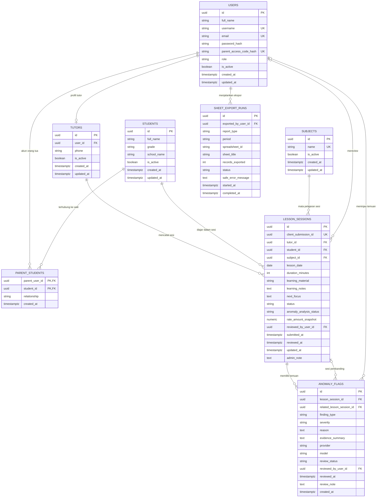

# ERD dan Data Dictionary

Dokumen ini menjadi acuan skema Neon PostgreSQL + Drizzle untuk MVP. Nama implementasi boleh mengikuti konvensi repo, tetapi makna relasi, otorisasi, status, dan aturan bisnis harus tetap konsisten dengan PRD, API contract, dan tests.

## Keputusan domain yang sudah ditetapkan

- Setiap submit tutor membuat satu record `lesson_sessions` dengan status awal `pending`.
- Admin memeriksa sesi sebelum sesi dihitung ke estimasi honor.
- Honor & tagihan memakai tarif les per jenjang (SD 1-3 Rp50.000/jam, SD 4-6 Rp70.000/jam; ≤ 60 menit = 1 jam, tiap 30 menit penuh berikutnya +0,5×) dikurangi potongan Admin Rp10.000 per sesi, dikunci ke `rate_amount_snapshot`/`admin_fee_snapshot` saat sesi dihitung (D-25). Tidak ada tabel penugasan atau tarif; Tutor memilih murid & 1–3 mapel sendiri (`lesson_session_subjects`).
- Materi pembelajaran disimpan di database dan dipakai di Riwayat Mengajar serta Progress Anak. Materi tidak masuk ekspor standar delapan kolom.
- Modul anomali mengklasifikasikan kandidat anomali, termasuk dugaan duplikasi. Hasil AI tidak otomatis menolak sesi atau mengubah honor.
- Ekspor Google Sheets hanya dilakukan atas permintaan Admin, per bulan, memakai delapan kolom mentah yang diminta UMKM.
- Periode selalu ditentukan oleh `lesson_date`; tidak dibuat tabel khusus per bulan.

## 1. ERD

## 2. Prinsip relasi

- Dashboard bukan tabel. Ketiga role membaca data yang sama melalui endpoint dengan filter akses masing-masing.
- `lesson_sessions` adalah transaksi utama: satu baris per sesi les yang disubmit.
- `lesson_sessions` merujuk langsung `tutors`, `students`, dan `subjects`: Tutor memilih murid dan mapel aktif sendiri saat absen (tanpa penugasan, D-24).
- `parent_students` membatasi siswa yang boleh dilihat akun orang tua.
- `users.username` dan `users.password_hash` digunakan untuk login Admin/Tutor. Orang tua hanya menggunakan `parent_access_code` yang menjadi kode rahasia akses; database menyimpan digest-nya, bukan kode mentah.
- Kode akses orang tua bukan `users.id`, ID siswa, NPM publik, nomor telepon, atau kode berurutan. Kode harus acak, sulit ditebak, hanya dibagikan privat, dapat dirotasi, dan dilindungi rate limit.
- Tidak ada tabel tarif. Tarif per jenjang & potongan Admin ada di `services/billing/tariff.ts`; tarif resmi UMKM masih O-01.
- `lesson_sessions.rate_amount_snapshot` ditetapkan saat sesi disetujui dari tarif konfigurasi; snapshot menjaga histori honor tidak berubah saat tarif konfigurasi diganti.
- `anomaly_flags` menyimpan hasil klasifikasi/indikasi anomali, termasuk `suspected_duplicate`. Status proses agregat disimpan di `lesson_sessions.anomaly_analysis_status`; `anomaly_flags.review_status` memiliki nilai `pending_review`, `confirmed_anomaly`, `false_positive`, `resolved`, dan `superseded` (khusus ditetapkan sistem saat Tutor merevisi payload). Temuan tidak mengganti `lesson_sessions.status` dan harus ditinjau Admin.
- `sheet_export_runs` mencatat tindakan ekspor Admin. Tidak ada status sinkronisasi per sesi karena Sheets bukan tujuan submit live.
- `no` pada tampilan dan ekspor adalah nomor urut sementara, bukan ID stabil. ID internal selalu UUID.

## 3. Data dictionary

### 3.1 `users` — akun dan autentikasi

| Kolom | Tipe/constraint | Tujuan dan layar |
|---|---|---|
| `id` | UUID PK | Identitas internal semua role. |
| `full_name` | VARCHAR NOT NULL | Nama untuk profil, Master Data, dan laporan. |
| `username` | VARCHAR UNIQUE NULL | Username login Admin/Tutor; wajib untuk role `admin` dan `tutor`, tidak dipakai orang tua. |
| `email` | VARCHAR UNIQUE NULL | Kontak opsional, bukan metode login utama. |
| `password_hash` | VARCHAR NULL | Hash password Admin/Tutor; tidak pernah dikirim ke client. |
| `parent_access_code_hash` | CHAR(64) UNIQUE NULL | Digest berkunci dari kode akses acak orang tua; hanya untuk role `parent`, tidak pernah mengembalikan kode mentah sesudah pembuatan. |
| `role` | CHECK: `admin`, `tutor`, `parent` | Pembatasan akses dashboard/API. |
| `is_active` | BOOLEAN DEFAULT true | Mengontrol apakah akun dapat login; nonaktifkan akses tanpa menghapus histori. |
| `created_at`, `updated_at` | TIMESTAMPTZ | Timestamp administrasi. |

Constraint role harus memaksa credential sesuai jenis akun: Admin/Tutor wajib punya username dan password hash; Parent wajib punya digest kode akses. `users.is_active` mengontrol kemampuan login, sedangkan `tutors.is_active`/`students.is_active` mengontrol kelayakan operasional untuk assignment baru. Simpan kode akses menggunakan HMAC-SHA-256 dengan secret server-side khusus (`PARENT_ACCESS_CODE_PEPPER`) dan generate kode berentropi tinggi. Jangan gunakan hash biasa untuk menyimpan password; password Admin/Tutor memakai password hashing yang sesuai seperti Argon2id atau bcrypt dengan konfigurasi yang aman.

**Tab:** Login, profil, Master Data → Tutor dan Orang Tua/Wali, role guard.

### 3.2 `tutors` — profil tutor

| Kolom | Tipe/constraint | Tujuan dan layar |
|---|---|---|
| `id` | UUID PK | ID profil tutor yang dirujuk sesi. |
| `user_id` | UUID FK → `users.id`, UNIQUE NOT NULL | Akun login tutor. |
| `phone` | VARCHAR nullable | Kontak operasional jika diperlukan. |
| `is_active` | BOOLEAN DEFAULT true | Status operasional tutor: hanya tutor aktif bisa submit sesi baru. Jika profil tutor dinonaktifkan tetapi akun `users.is_active` tetap aktif, akses histori sendiri dapat dipertahankan sampai akun login dinonaktifkan. |
| `created_at`, `updated_at` | TIMESTAMPTZ | Metadata perubahan. |

**Tab:** Master Data → Tutor; Dashboard Admin; Data Absensi/Rekap/Honor melalui relasi; Profil Tutor.

### 3.3 `students` — master siswa

| Kolom | Tipe/constraint | Tujuan dan layar |
|---|---|---|
| `id` | UUID PK | ID internal siswa. |
| `full_name` | VARCHAR NOT NULL | Nama di form, absensi, rekap, dan progres. |
| `grade` | VARCHAR NOT NULL | Kelas siswa. |
| `school_name` | VARCHAR NOT NULL | Asal sekolah. |
| `is_active` | BOOLEAN DEFAULT true | Mengontrol sesi baru (pilihan Form Absensi). Histori yang sudah disimpan tetap dipertahankan; relasi orang tua aktif tetap dapat melihat sesi approved historis. |
| `created_at`, `updated_at` | TIMESTAMPTZ | Metadata. |

**Tab:** Master Data → Siswa; Form Tutor auto-fill kelas/sekolah; Data Absensi, Rekap, Progress Anak.

### 3.4 `parent_students` — hubungan orang tua dan anak

| Kolom | Tipe/constraint | Tujuan dan layar |
|---|---|---|
| `parent_user_id` | UUID FK → `users.id`, bagian PK gabungan | Akun parent yang terhubung. Harus role `parent`. |
| `student_id` | UUID FK → `students.id`, bagian PK gabungan | Anak yang boleh diakses akun tersebut. |
| `relationship` | VARCHAR nullable | Hubungan, misalnya ibu/ayah/wali. |
| `created_at` | TIMESTAMPTZ | Waktu relasi dibuat. |

PK gabungan (`parent_user_id`, `student_id`) mencegah relasi ganda. Satu akun parent dapat terhubung ke beberapa siswa; semua API tetap memeriksa relasi ini.

**Tab:** Master Data → Orang Tua/Wali; Dashboard Orang Tua.

### 3.5 `subjects` — mata pelajaran

| Kolom | Tipe/constraint | Tujuan dan layar |
|---|---|---|
| `id` | UUID PK | ID mapel. |
| `name` | VARCHAR UNIQUE NOT NULL | Nama mapel. |
| `is_active` | BOOLEAN DEFAULT true | Mengontrol pilihan mapel di Form Absensi. |
| `created_at`, `updated_at` | TIMESTAMPTZ | Metadata. |

**Tab:** Master Data → Mata Pelajaran; Form Tutor, Data Absensi, Rekap, dan Progress Anak.

### 3.6 `lesson_sessions` — catatan pertemuan/absensi

| Kolom | Tipe/constraint | Tujuan dan layar |
|---|---|---|
| `id` | UUID PK | ID stabil sesi, dipakai relasi dan audit internal. |
| `client_submission_id` | UUID UNIQUE NOT NULL | Idempotency key dari frontend, dipakai ulang pada retry submit yang sama agar network retry/double click tidak membuat sesi kedua. Berbeda dari deteksi anomaly untuk dua submit berbeda. |
| `tutor_id` | UUID FK → `tutors.id` NOT NULL | Tutor yang mencatat sesi (dari session login, bukan dari body). |
| `student_id` | UUID FK → `students.id` NOT NULL | Murid yang dipilih Tutor (harus aktif saat submit). |
| `subject_id` | UUID FK → `subjects.id` NOT NULL | Mata pelajaran yang dipilih Tutor (harus aktif saat submit). |
| `lesson_date` | DATE NOT NULL | Tanggal sesi; dasar semua filter bulan. |
| `duration_minutes` | INTEGER NOT NULL | Durasi konsisten dalam menit. |
| `learning_material` | VARCHAR NOT NULL | Materi; muncul di detail Riwayat Mengajar dan Progress Anak. |
| `learning_notes` | TEXT NULL | Catatan pembelajaran dari tutor. |
| `next_focus` | TEXT NULL | Fokus belajar berikutnya. |
| `status` | CHECK `pending`, `approved`, `revision_requested`, `rejected`; default `pending` | Siklus review admin. |
| `anomaly_analysis_status` | CHECK `pending`, `completed`, `failed`, `not_evaluated`; default `pending` | Status agregat analisis untuk sesi. Ini sumber status proses yang otoritatif; tabel `anomaly_flags` hanya menyimpan finding yang dihasilkan. |
| `rate_amount_snapshot` | NUMERIC NULL | Tarif les (kotor) per jenjang yang dikunci saat sesi dihitung (approved); NULL selain itu. |
| `admin_fee_snapshot` | NUMERIC NULL | Potongan Admin per sesi yang dikunci bersamaan; honor tutor = `rate_amount_snapshot − admin_fee_snapshot`. |
| `reviewed_by_user_id` | UUID FK → `users.id` NULL | Admin yang meninjau payload sesi saat ini; direset ke NULL saat Tutor mengirim revisi payload baru. Full audit history tidak disimpan pada baseline. |
| `submitted_at` | TIMESTAMPTZ NOT NULL | Waktu submit payload sesi yang saat ini tersimpan; diperbarui saat Tutor mengirim revisi. Baseline tidak menyimpan seluruh sejarah submit. |
| `reviewed_at` | TIMESTAMPTZ NULL | Waktu review terakhir atas payload saat ini; direset ke NULL ketika payload direvisi oleh Tutor. |
| `updated_at` | TIMESTAMPTZ NOT NULL | Waktu record terakhir diperbarui. |
| `admin_note` | TEXT NULL | Catatan internal untuk payload saat ini, termasuk alasan revisi/penolakan; tidak ditampilkan ke orang tua dan direset ketika Tutor mengirim revisi baru. |

Saat submit, `status='pending'`. Ketika sesi `revision_requested` direvisi, `submitted_at` diperbarui ke waktu submit revisi; `reviewed_by_user_id`, `reviewed_at`, dan `admin_note` direset karena metadata review hanya berlaku untuk payload terbaru. Riwayat payload/keputusan terdahulu tidak disimpan pada baseline. Hanya sesi `approved` yang dapat masuk ke estimasi honor. Tarif snapshot ditetapkan dari tarif assignment yang aktif pada `lesson_date` sesuai aturan implementasi; sesi tanpa tarif tidak boleh diberi nominal palsu. Nominal demo harus terlihat sebagai simulasi.

**Tab:** Form Absensi, Riwayat Mengajar, Data Absensi, Rekap, Honor Tutor, Honor Saya, Progress Anak (field publik yang disetujui).

### 3.7 `anomaly_flags` — hasil deteksi/klasifikasi anomali

| Kolom | Tipe/constraint | Tujuan dan layar |
|---|---|---|
| `id` | UUID PK | ID temuan. |
| `lesson_session_id` | UUID FK → `lesson_sessions.id` NOT NULL | Sesi yang dianalisis. |
| `related_lesson_session_id` | UUID FK → `lesson_sessions.id` NULL | Sesi pembanding bila temuan duplikasi/pola berulang. |
| `finding_type` | CHECK `suspected_duplicate`, `duration_outlier`, `unusual_pattern` | Jenis finding baseline. Input invalid ditangani validator deterministik; `invalid_data` bukan finding AI untuk submit baru. |
| `severity` | VARCHAR NOT NULL | Label prioritas review seperti `low`, `medium`, `high`; bukan kepastian kecurangan. |
| `reason` | TEXT NOT NULL | Alasan yang bisa dibaca Admin. |
| `evidence_summary` | TEXT NULL | Ringkasan data pendukung dengan PII minimum. |
| `provider`, `model` | VARCHAR NULL | Provider/model yang menghasilkan klasifikasi jika AI dipakai. |
| `review_status` | CHECK `pending_review`, `confirmed_anomaly`, `false_positive`, `resolved`, `superseded`; default `pending_review` | Status review manusia, dipisahkan dari status sesi. |
| `reviewed_by_user_id` | UUID FK → `users.id` NULL | Admin yang meninjau. |
| `reviewed_at` | TIMESTAMPTZ NULL | Waktu review. |
| `review_note` | TEXT NULL | Keputusan/keterangan Admin. |
| `created_at` | TIMESTAMPTZ NOT NULL | Waktu finding dibuat. |

Anomaly module mengklasifikasikan dugaan duplikasi/pola anomali. Validasi struktur tetap deterministik. AI tidak boleh otomatis menghapus record, menolak sesi, atau mengubah honor. Admin dapat menandai `confirmed_anomaly`, `false_positive`, atau `resolved`. Sistem menandai finding lama `superseded` secara otomatis ketika Tutor mengirim revisi payload; status ini bukan keputusan manual Admin.

**Tab:** Admin → Data Absensi (indikator, detail, dan review). Temuan internal tidak ditampilkan kepada Tutor/Orang Tua secara mentah.

### 3.10 `sheet_export_runs` — histori ekspor bulanan

| Kolom | Tipe/constraint | Tujuan dan layar |
|---|---|---|
| `id` | UUID PK | ID percobaan ekspor. |
| `exported_by_user_id` | UUID FK → `users.id` NOT NULL | Admin yang memulai ekspor. |
| `report_type` | VARCHAR NOT NULL | Saat MVP: `attendance`. |
| `period` | VARCHAR `YYYY-MM` | Bulan yang diekspor. |
| `spreadsheet_id` | VARCHAR NOT NULL | ID spreadsheet tujuan ketika ekspor dijalankan; bukan credential. Dibutuhkan agar histori menunjuk ke file yang benar jika konfigurasi berubah kemudian. |
| `sheet_title` | VARCHAR NOT NULL | Nama tab tujuan, contoh `Absensi 2026-10`. |
| `records_exported` | INTEGER NOT NULL DEFAULT 0 | Jumlah baris data yang ditulis, tidak termasuk header. |
| `status` | VARCHAR: `running`, `succeeded`, `failed` | Status percobaan. |
| `safe_error_message` | TEXT NULL | Pesan error aman tanpa credential/payload sensitif. |
| `started_at` | TIMESTAMPTZ NOT NULL | Waktu ekspor mulai. |
| `completed_at` | TIMESTAMPTZ NULL | Waktu ekspor selesai; `NULL` selama status `running`, terisi saat status menjadi `succeeded` atau `failed`. |

**Tab:** Admin → Rekap → status dan histori ekspor. Sheets tetap snapshot; perubahan setelah ekspor membutuhkan ekspor ulang.

## 4. Constraint dan indeks yang disarankan

- Unique index untuk `users.username` saat tidak NULL dan `users.parent_access_code_hash` saat tidak NULL; `email` unik jika diisi.
- Role credential check: `admin`/`tutor` membutuhkan `username` dan `password_hash`; `parent` membutuhkan `parent_access_code_hash`.
- FK dan constraint unique untuk relasi orang tua-anak, nama mapel, dan ID yang relevan.
- Index pada `lesson_sessions.lesson_date`, `lesson_sessions.status`, `lesson_sessions(tutor_id, lesson_date)`, `lesson_sessions(student_id, lesson_date)`, serta kombinasi yang mendukung query laporan bulanan.
- Index pada `anomaly_flags.lesson_session_id` dan status review; `sheet_export_runs.period` serta `started_at`.
- Gunakan soft deactivation untuk master data yang sudah digunakan. Hindari cascade delete sesi historis.
- `client_submission_id` harus unique dan wajib pada submit awal. Frontend membuat UUID sekali untuk submission dan menggunakan ulang pada retry; backend mengembalikan record sesi yang sama untuk key/body yang sama dan `409` bila key sama dipakai untuk payload berbeda. UI tetap mencegah double-click.

### 4.1 Implementasi (Phase 03, `backend/src/db/schema.ts` + `backend/drizzle/`)

- **Migration 0003–0004 (D-24)**: kolom `tutor_id/student_id/subject_id` diisi dari penugasan lama (data sesi dipertahankan), lalu tabel `tutor_assignments`/`tutor_rates` dan kolom `assignment_id`, `rate_type_snapshot`, `rate_is_demo_snapshot` dihapus. Extension `btree_gist` dari migration 0001 tetap terpasang (tidak lagi dipakai).
- **`users.credential_version`** (kolom implementasi tambahan, `INTEGER DEFAULT 1`): dinaikkan saat password diganti, kode akses parent dirotasi, atau login dinonaktifkan. Session yang membawa versi lama otomatis dicabut pada request berikutnya.
- **CHECK tambahan di `lesson_sessions`**: snapshot tarif (jika ada) positif dan hanya untuk `approved`; `admin_note` wajib untuk `revision_requested`/`rejected`; status selain `pending` wajib punya `reviewed_by_user_id` + `reviewed_at`; `duration_minutes > 0`.
- Uang `NUMERIC(12,2)`; semua FK `ON DELETE RESTRICT` (tidak ada cascade delete histori); nama mapel unik case-insensitive (`lower(name)`), email unik case-insensitive.
- **`app_sessions`** (infrastruktur, bukan entitas domain): `sid VARCHAR PK`, `sess JSON`, `expire TIMESTAMP(6)` + index `expire` — kompatibel `connect-pg-simple`, dibuat lewat migration (`createTableIfMissing=false`).

## 5. Aturan waktu dan bulan

- `lesson_date` adalah `DATE` tanpa jam; jangan menggesernya karena konversi zona waktu.
- `submitted_at`, `reviewed_at`, dan `updated_at` adalah `TIMESTAMPTZ`.
- API menggunakan `period=YYYY-MM`, lalu query `lesson_date >= first_day AND lesson_date < first_day_next_month`.
- Sesi tanggal 31 Oktober yang baru dilaporkan pada November tetap termasuk Oktober.
